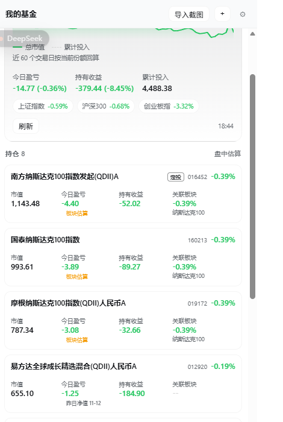

# 我的基金 · dsh-my-funds

DSH 左侧栏里的基金助手：**导入持仓截图 → 自动看每日盈亏、持有收益、定投汇总**。盘中用实时估值预估当天收益，收盘后切回官方净值。



## English

A fund-portfolio panel for the DSH sidebar. You import screenshots of your positions from broker apps (Guotai, Nanfang, Morgan, E Fund, Alipay/Ant Fortune, Tiantian Fund), and the plugin reads them with the built-in Windows OCR engine, then keeps the numbers up to date by pulling public NAV data from Eastmoney.

What it does:

- **Screenshot import** — Windows WinRT OCR (no cloud, no API key), with several layout parsers that pick themselves: table header rows, label-above-value cards, one-fund-per-row lists, and single-fund "asset detail" pages. Holding screenshots and DCA-plan screenshots are imported separately.
- **Daily P&L with a five-step chain** — intraday estimate (`gsz`) → the app's own "today's gain" from an imported detail page → official NAV once published → tracked-sector index change → previous trading day. Each row labels which link it used.
- **Sector column** — maps a fund name to its tracker index (Nasdaq 100, S&P 500, CSI 300, CSI 500, ChiNext, STAR 50, liquor, gold, oil, …) and shows that index's change next to the holding.
- **DCA plans** — import the plan screenshot or add one by hand; each due date buys `amount / NAV` shares from the historical NAV series, weekends roll to the next trading day, holidays are skipped, and money still in transit is tracked separately.
- **Multi-channel de-duplication** — a fund bought both in Alipay and in the fund company's own app appears as one position; the fund-company figure (all channels) wins and the reseller part is noted as already included.
- **Email report twice a day** — a morning estimate and an evening settlement, sent over plain SMTP (no dependency); the same message can also be pushed through an OneBot endpoint configured in the settings file.
- **Mobile page** — a read-only page served on the LAN so you can check it from your phone.

Install (from this repo):

```sh
dsh plugin add https://github.com/wdbaolongzs/dsh-my-funds
```

or point the DSH plugin manager at a local checkout. The host must be Windows desktop — screenshot import goes through `powershell.exe` and `Windows.Media.Ocr`; elsewhere manual entry and quote tracking still work.

Data source: `fundmobapi.eastmoney.com` (quotes and intraday estimate), `danjuanfunds.com` / `api.fund.eastmoney.com` (NAV history), `fundsuggest.eastmoney.com` (name → code), `push2.eastmoney.com` (index quotes). No account, no key, no scraping of your broker.

MIT licensed.

---

## 中文说明（下面开始是完整文档）

## 怎么用

左侧栏图标（第 4 个，橙色折线）→ 点开就是「我的基金」面板。

1. **导入截图**：点右上「导入截图」，把国泰 / 南方 / 支付宝 / 天天基金的**持仓截图或定投计划截图**拖进来、或 Ctrl+V 粘贴、或点「选择图片」。
   - **持仓截图和定投截图分开导**（这也是最省事的用法）：弹窗顶部选 `自动识别` / `只导持仓` / `只导定投`，一张图只喂一种用途，成本与份额永远不会互相污染。
   - **来源要选对**（`截图来源`：自动识别 / 基金公司 APP / 支付宝等代销 / 未识别）。自动识别靠截图里的字判断：出现「基金管理有限公司 / 我的基金账户 / 直销 / 官方APP / 活期宝 / 现金宝」→ 基金公司；出现「支付宝 / 蚂蚁财富 / 天天基金 / 理财通 / 蛋卷 / 京东金融 / 东方财富 / 同花顺」→ 代销。
   - **同一只基金多渠道合并**：基金公司 APP 的份额是**全渠道合计**（含你在支付宝买的），代销 APP 只显示自己那部分。所以按 code 分组时 **基金公司口径优先**，代销那张的行被吸收成备注，例如 `已含 支付宝等代销 ¥300.00`，不计第二份市值/成本。
   - **重复导入保护**：已经按基金公司口径存了 800，再单独导支付宝那张 300，会被判定 `duplicate` 直接跳过（弹窗里提示「已跳过 N 行：基金公司 APP 已包含该份额」），不会变成 1100。
   - **定投识别规则**：同一行（或名称下面紧邻的行）出现 `定投 / 每期 / 每周X / 每月N日 / 每个交易日 / 扣款` 等字样，就当作定投计划；金额取该行最小的那个金额（`累计定投`、`已投` 这类累计值会被忽略）。
   - **整页定投详情也能认**（易方达/南方「定投详情」「普通定投详情」页）：这类页面把计划块放在基金名下方 600~900px 处，锚点法看不到，所以改用整页解析——页面出现 `下次扣款 / 下次转入 / 扣款周期 / 定投方式 / 定投详情 / 普通定投` 任一字样就按整页一个计划处理：名称取页面里第一只基金、周期读 `每日 / 每周X / 每月N日`、金额取页面里最小的两位小数金额（`累计定投 40.00`、`已投期数 4` 都会被排除）、下次扣款日支持完整 `2026-11-13` 与 `12-10` 两种写法（OCR 把日期拆成 `2026． 1 1 ¦ 一13（星期五）` 也能还原）。
   - **定投从截图上的「下次扣款」开始往后补齐**（基金公司的算法）：`下次扣款 12-10` → 计划锚定 12-10，`lastRun` 设为该日之前的上一期（11-10，说明这期已含在持仓成本里），之后每期自动按当日历史净值买入份额、累加成本；周末顺延到下一个交易日，节假日无净值自动跳过。导入不追溯截图之前的历史。
   - 没有截图也可以「粘贴文本」，一行一条，例如 `招商中证白酒 161725 3210.45 +45.20` 和 `110022 每周一 300`。
   - 也可以点「＋」直接搜索基金名称添加。
   - **「资产详情」页优先**：基金公司 App 里点进单只基金那页（有 `基金资产 / 日收益(日期) / 持仓收益 / 最新净值 / 平均成本 / 持仓成本 / 持有份额`）是最新、最全的一版——它比持仓列表新一天，还把「2 笔交易确认中」的在途金额算进去了。插件能认出这种页面时直接用它的市值、份额、成本，并把**当日收益**当作当天最准的数（行内标 `当日实际`），过期（隔天）自动失效。
   - **列表页与详情页数字不一样是正常的**：列表页常写着「收益更新中 / 2 笔交易确认中」，那是**上一交易日**的结算值；详情页是**最新**的。**认详情页**。实测：列表 1,118.82 / -76.68 / 日收益 -6.66(11-11)，详情页 1,143.48 / -52.02 / 日收益 +24.66(11-12)；插件按详情页记，市值 1,143.48（含在途 20.00）、当日 +24.66、持有收益 -52.02 三个数与 App 完全一致。
   - **在途金额**：已扣款未确认份额的钱（那 20 元）计入市值与成本，但不产生当日盈亏（当日盈亏只按已确认份额算）。
   - **支持的截图版式**（几种解析器自动切换，取识别得分最高的那个）：
     1. **横排表格**（支付宝「我的持有」、天天基金持仓）：表头 `名称 | 金额/昨日收益 | 持有收益/率`，每列上下两个数字按表头顺序对应；名字跨两行（如 `摩根纳斯达克100指数` + `(QDII)A`）会合并；行内「定投」tag 只作标记，不会误建成定投计划。
     2. **标签在上、数值在下**（国泰「我的基金」）：`金额（元）/ 昨日收益（元）/ 持有收益（元）` 标签下面才是数字，且**可能完全没有基金代码**——这时按名称去东财搜索、用官方全名匹配出代码（国泰纳斯达克100指数 → 160213）。
     3. **一行一只基金**（南方基金 APP 等）：名称、代码、市值、收益、收益率在同一行或紧邻行。
     4. **单只基金的「资产详情 / 持仓详情 / 持有详情」页**——同一类页面，各 App 叫法不同，插件认标题和 `金额/基金资产` 标签：
        - 南方基金 App：`基金资产(元) 1,143.48` + `日收益(11-12) / 持仓收益 / 持仓收益率` + `最新净值 / 平均成本 / 持仓成本 / 持有份额`
        - 支付宝（蚂蚁）：`金额(元) 656.35` + `今日收益(元) / 持有收益(元) / 持有收益率`
        - 摩根基金 App：`金额(元) 9.79` + `11-11收益(元) / 持仓收益 / 持仓涨跌幅`（日收益标签里带日期，说明那是上一交易日）
        - 国泰基金 App：`金额（元） 993.60` + `今日收益已更新 22.88` + `持有收益 / 持有收益率` + `持有份额 / 待确认金额 / 最新净值`
     识别后直接给出份额与成本，不用反推；`待确认金额` 会当作在途金额；标签里带日期（如 `11-11收益`）就按那一天算，只有写「今日/日收益(当天)」的才计入今天的盈亏。
   - **多张图一起导不会漏**：每张图各自识别，再按代码合并；**认不出代码的行也不会丢**（按名称分组，两条不同基金不会并成一条），只有同一只基金多渠道/多张图才会合并成一行并标 `已含 …`。
   - **OCR 容错**：全角 `．％`、负数被读成 `· 6 · 30`（`·` 当负号）、`一` 当负号、`S`→`5`、`O`→`0`、`B`→`8`、`L`→`1`、`Z`→`2` 都会自动修正；`持有金额800.00` 这种标签与数值粘连也能取到金额；`（QDII）A` 被 OCR 拆成三格会重新拼回，`I` 类被读成 `《` 也会还原；`●`/`○`/`①` 这类图标不会被当成 0。
   - **小数点丢了也能救**：OCR 常把 `787.34` 读成 `78Z34`、`21.86%` 读成 `2L86%`、`1.26` 读成 `L26`。插件会把每个数字的两种可能（原值 / 除以 100）都列出来，再用「收益率 = 收益 ÷（市值 − 收益）」这条恒等式挑出合理的那个（`78Z34` → 782.34，与 App 的 787.34 差 5 元是 OCR 把 7 认成 2，属字形误差）。
   - **标签与数值并排也能取**：`持有份额 233.46`、`待确认金额 0.00` 这种同一行左右排布的，会先看右边再找下一行。
   - **认不出就不猜**：按名称搜代码时要求标题重叠度 ≥ 0.45（比如「连续3年正收益」这种营销文案不会匹配到某只债券基金），低于阈值就留空代码等你手填，绝不张冠李戴。
   - **同代码不同份额**：`A`/`I` 类被解析成同一只基金时市值/收益会相加，而不是丢掉一条。
2. **看数据**：顶部卡片是总市值、今日盈亏（金额+幅度）、持有收益、累计投入、45 天走势（实线市值、虚线成本）、指数条。下面按市值排序列出每只基金，每行四列：**市值 / 今日盈亏 / 持有收益 / 关联板块**（关联板块那列显示跟踪指数当天涨跌，如 `+1.60% 纳斯达克100`，和养基宝一样单独成列；没有对应板块的基金也保留这一列、显示 `--`，保证四列在所有行上对齐）；今日盈亏下方的小标签说明这个数字的来源（`板块估算` / `今日净值` / `盘中估值` / `昨日净值 11-11`）。点一行可以改份额/成本或删除。
3. **设定投**：「＋新增定投」→ 选基金、每期金额、每交易日 / 每周几 / 每月几日、起始日。之后每天自动按历史净值把买入份额和成本记进持仓（周末自动顺延到周一，节假日无净值自动跳过），也可以点「补算到今天」一次性补齐历史期数。
4. **自动更新**：后台每 5 分钟拉一次行情；面板开着时每分钟刷新一次（页面隐藏时暂停）。
5. **⚙ 设置**：自动更新开关、OCR 语言、清空持仓 / 清空全部数据。

## 今日盈亏怎么算（四档口径）

每只基金的当日盈亏都是「份额 ×（现价 − 昨收）」，现价按可信度从高到低取：

| 标签 | 含义 | 触发条件 |
|---|---|---|
| 盘中估值 | 东财实时估值 | 交易时段有 `gsz` |
| 当日实际 | **App 资产详情页给的当日收益**，与基金公司完全一致 | 导入过该基金当天的资产详情页 |
| 今日净值 | **官方净值，最准** | 当日净值已出（A股基金一般当晚 20:00 前后、QDII 次日晚） |
| 板块估算 | 用**关联板块**涨跌推算 | 净值还没出，但能对上跟踪指数 |
| 昨日净值 | 上一交易日的官方涨跌 | 上面都不满足（提示里会带日期） |

- **关联板块映射**（和养基宝一个思路，提前看到今天大概挣多少）：纳斯达克100 → `100.NDX`、标普500 → `100.SPX`、道琼斯 `100.DJIA`、恒生科技 `124.HSTECH`、恒生 `100.HSI`、沪深300 `1.000300`、中证500 `1.000905`、中证1000 `1.000852`、创业板 `0.399006`、科创50 `1.000688`、中证白酒 `0.399997`、中证医疗 `0.399989`、半导体 `0.990001`、中证新能 `0.399808`、上证红利 `1.000015`、上证50 `1.000016`、伦敦金 `101.GC00Y`、原油 `101.CL00Y`。一次批量请求（`push2.eastmoney.com/api/qt/ulist.np/get`），缓存 60 秒。
- 列表里每行右侧会显示标签（`板块估算` / `今日净值` / `昨日净值 + 日期`）和对应的板块涨跌，例如 `纳斯达克100 +1.60%`；点开弹窗不会影响估值来源。
- **收盘后自动变准**：净值一出来，同一行就会从「板块估算」切到「今日净值」，数值随之变成基金公司公布的官方涨跌，历史快照也是按官方净值存的。

## 数据

- 状态文件：`<DSH_PROFILE_DIR>/my-funds/state.json`（持仓、定投计划、每日快照、净值缓存），原子写入。
- 持仓字段：`{code, name, shares, cost, channel, note, autoInvest}`，`channel` 取 `direct | platform | unknown`（有它才能做渠道合并与去重）。
- 行情与估值：`fundmobapi.eastmoney.com`（批量行情 + 盘中估值）
- 板块/指数：`push2.eastmoney.com/api/qt/ulist.np/get`（关联板块批量行情，用于板块估算）
- 历史净值（定投回溯）：`danjuanfunds.com`，失败回退 `api.fund.eastmoney.com/f10/lsjz`
- 名称搜索：`fundsuggest.eastmoney.com`
- 指数：`push2.eastmoney.com`（上证 / 沪深300 / 创业板指，30s 缓存）
- 截图 OCR：`lib/ocr.ps1` 调系统 `Windows.Media.Ocr`（zh-Hans-CN），无需联网、无需额外安装；系统缺少中文 OCR 语言包时会提示改用手贴文本。

## 接口

`POST /my-funds/api/{state|refresh|import|holdings|plans|settings|search}`，返回 `{ ok, value }`；`GET /my-funds/api/state` 也可用。
跨站请求（`sec-fetch-site: cross-site` 或跨 host 的 Origin）一律 403。

## 开发

```
lib/core.js    纯函数：OCR 版式重排、文本/单元格解析、持仓归一化、收益计算、定投排期
lib/index.js   host 半：状态文件、行情/历史/搜索抓取、定投结算、路由、定时器
lib/client.js  客户端半：sidebar.panellist 图标 + main 面板、四个对话框
lib/ocr.ps1    WinRT OCR 脚本（内存流读图，输出带坐标的 words）
```

改完代码后让运行中的 host 生效：`plugin_manager set_plugin target=include:my-funds enabled=false` → `true`（会重新导入磁盘上的最新文件）；客户端部分刷新页面即可。

## 刷新与自动结算（v0.1 优化后）

| 场景 | 行为 |
| --- | --- |
| 行情缓存 | 交易时段（9:30–11:30 / 13:00–15:00）1 分钟一次，其余时间 5 分钟一次；点「刷新」强制拉取 |
| 面板轮询 | 盘中 60 秒一次，收盘后 300 秒一次；浏览器标签在后台时不请求 |
| 定投结算 | 跨天、距上次结算超过 30 分钟、或手动刷新时触发；同一笔买入按日期去重，不会重复扣款 |
| 净值没出的那一天 | 不推进 `lastRun`，等净值公布后会补买这一期；超过 2 天仍无净值（长假/停牌）才放弃并跳过 |
| 数据过期提示 | 行情超过 15 分钟没更新，页脚显示「行情可能过期，点刷新重试」 |
| 页脚信息 | 更新于 HH:MM · 下次刷新 N 分钟 · 结算至 YYYY-MM-DD · 数据源 |

插件只在 DSH 运行时工作：关掉 DSH 就不会自动结算，但下次打开时会一次性把落下的天数补齐（按历史净值逐日买入）。

## 邮件 / QQ 推送（一天两条）

面板 ⚙ 里填 QQ 邮箱账号、SMTP 授权码、收件邮箱，勾上「每天定时推送」，两个时间可各自改：

| 时间 | 内容 |
| --- | --- |
| **08:00 早盘预估** | 用关联板块推算当天盈亏，每行标注「板块估算 / 今日净值」，末尾提示净值公布后以官方为准 |
| **21:30 收盘结算** | 官方净值口径；还没出净值的会写明「N 只净值未出仍为估算」，并列出当天定投是否落地（金额·份额·净值） |

实现说明：
- SMTP 自研（`lib/notify.js`），不依赖 nodemailer；465 隐式 TLS 与 587 STARTTLS 都支持，一个不通自动换另一个。回复先入队列，避免「服务器抢先说话」导致的读取超时；正文与结束行 `.` 一次写入，避免 DATA 阶段互相等待。
- 同一天同一时刻只发一条（`lastSent` 记 `YYYY-MM-DD HH:MM`）。
- 授权码只存本机 `<profile>/my-funds/state.json`，接口回显为掩码。

## 自检（改完代码跑一遍）

```bash
# 1) 算账口径（纯函数，不联网、不改数据）
node test/audit-core.mjs

# 2) 线上三项不变式 + 幂等（只读与幂等操作）
node test/audit-live.mjs http://127.0.0.1:<GUI端口>

# 3) 截图解析回归（需要 work/ 下的 OCR 样本）
node ../test-samples.mjs
```

`audit-live` 检查的东西就是历史上翻车的几件事：

| 检查 | 对应曾经的问题 |
| --- | --- |
| 份额 = 基准份额 + 已记录期数 | 定投把历史期重放，份额凭空多 200 |
| 成本 = 基准成本 + 在途 + 已记录成本 | 在途被当成份额，成本翻倍 |
| 同一只基金只有一条计划 | 重复建计划导致同一期买两次 |
| 连续刷新市值不变 | 基准每次加载往后挪，越刷越多 |
| 重复导入同一张截图份额不变 | 重导同图重复累加 |
| 更小的旧截图被识别为 stale | 旧截图把基准拽回去 |

## 数据口径（三句话记住）

1. **份额**只来自「截图基准 + 之后真正成交的期数」，任何时候都能反算。
2. **在途（待确认）金额**算进市值与成本，但不产生收益；它只会在净值出来后换成份额，成本不再加。
3. **今日盈亏**优先级：截图带来的当日实际 > 盘中估值 > 今日官方净值 > 关联板块推算 > 昨日净值。
